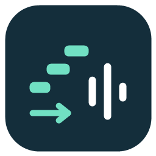

# Vocal Grid

[简体中文](README.zh-CN.md) · English



A lightweight, native MIDI-to-Synthesizer V Studio 2 project converter. Import a MIDI file, enter the tempo and time signature, and generate `vocal.svp` with quantized notes and dry stem export settings.

## Native apps

| Platform | Implementation | Requirements |
| --- | --- | --- |
| Windows | C# / WinForms | Windows with .NET Framework 4.x |
| macOS | SwiftUI / AppKit | macOS 13 or later; Apple Silicon or Intel |

No Electron, web runtime, third-party MIDI parser, voice database, or singing synthesis engine is bundled. Synthesizer V performs the actual audio rendering after you open the generated project.

## Features

- Quantize note starts and ends to the nearest 1/32 note, with a minimum duration of one grid step.
- Use a fixed BPM and time signature supplied by the user, replacing MIDI tempo/meter changes while preserving musical beat positions.
- Name output tracks `Melody1`, `Melody2`, and so on. Split MIDI channels and overlapping notes into separate monophonic voices without discarding chord notes.
- Default to first-generation **Mai**. Enter another singer's exact project database name and select its AI generation when needed. This name is not an activation code or product UUID.
- Set Mandarin Chinese on all notes. Preserve MIDI lyric events when available; otherwise use the editable default lyric `啦`.
- Drag and drop MIDI files or folders. When several MIDI files are found, select one from a list. Folder discovery is nonrecursive.
- Drag a folder onto the output section to choose where to save `vocal.svp`.
- Back up an existing project before writing its replacement. Original MIDI files are never modified.

## Export preset

| Option | Value |
| --- | --- |
| Output | Stems only; all generated tracks selected; no mixdown |
| Bypass gain and pan | On |
| Bypass effects | On |
| Channels | Stereo |
| Aspiration output | None (`noAspiration`) |
| Bit depth / sample rate | 24-bit / 48,000 Hz |
| Audio name prefix | `vocal` |
| Export destination | Same folder as the generated project |

The two bypass switches are both enabled. “Aspiration: None” refers to the editor's export option; the converter does not apply additional audio processing.

## Download from private CI

Open **Actions → Build native apps → a successful run → Artifacts**. Repository access and a GitHub login are required. Artifacts remain private under the repository's access controls and expire after 14 days. This workflow does not publish GitHub Releases or change repository visibility.

- `VocalGrid-macOS-universal`: contains a ZIP with `Vocal Grid.app` and a SHA-256 checksum. Extract the artifact download, then extract the inner app ZIP.
- `VocalGrid-Windows`: contains `MidiToVocal.exe`.

The macOS package is locally ad-hoc signed. It is not Developer ID signed or notarized. Cloud compilation checks the application build, core tests, bundle structure, signature integrity, and both CPU architectures; it does not verify Synthesizer V voice activation or audio output.

## Use

1. Open the app and select or drop a MIDI file.
2. Enter BPM (quarter notes per minute), time signature, and optional default lyric.
3. Leave `Mai` + first-generation selected, or enter another singer's exact database name and generation.
4. Choose the destination folder, then generate `vocal.svp`.
5. Open it in Synthesizer V Studio 2, wait for synthesis, then export the selected stems.

The singer must be installed and activated locally and support Mandarin. Singer names are not validated online. The converter cannot infer missing song lyrics from MIDI notes.

On Windows, the default destination is the executable's directory. On macOS, it is the `.app`'s enclosing folder. Select a writable directory if the app is located in a read-only or protected location. Previous files receive timestamped `.bak` backups.

## Build locally

### Windows

From the repository root in PowerShell:

```powershell
./windows/build.ps1
./tests/windows/verify.ps1
```

Output: `dist/windows/MidiToVocal.exe`. The Windows installation's .NET Framework C# compiler is used. No extra SDK is required.

### macOS

Install Xcode 15+ or Command Line Tools with Swift 5.9+, then run:

```bash
bash macos/build-macos.sh
# Or build both CPU architectures:
bash macos/build-macos.sh --universal
```

Output: `macos/dist/Vocal Grid.app`. The script runs the test suite before compiling and packaging. You can also open `macos/Package.swift` in Xcode.

## Cloud builds

The GitHub Actions workflow runs on changes to app sources, tests, assets, or the workflow itself. It can also be triggered manually with **Run workflow**. It tests and builds both native apps, packages a universal macOS app, and uploads private artifacts. It uses standard GitHub-hosted runners; usage is subject to the account's private Actions allowance and billing settings. No secrets or Apple developer certificates are required.

## MIDI scope

Supports standard MIDI format 0/1 with PPQ timing, running status, velocity-zero Note Off, and UTF-8/Chinese legacy lyric decoding. Channel 10 percussion is skipped by default. Sustain pedal, pitch bends, velocity shaping, instrument patches, mixer settings, and other CC events are not mapped to singing parameters. SMPTE timing and MIDI format 2 are rejected with an error.

## Project structure

```text
windows/       Native Windows UI and converter
macos/         Swift package, native Mac UI, converter, tests, packaging
assets/        Shared icon artwork and Windows app resources
tests/windows/ Windows conversion and native drop-event checks
.github/       Private artifact build workflow
```

This tool is an independent utility and is not affiliated with Dreamtonics. No proprietary voice data, activation credentials, or user MIDI/projects are included.
